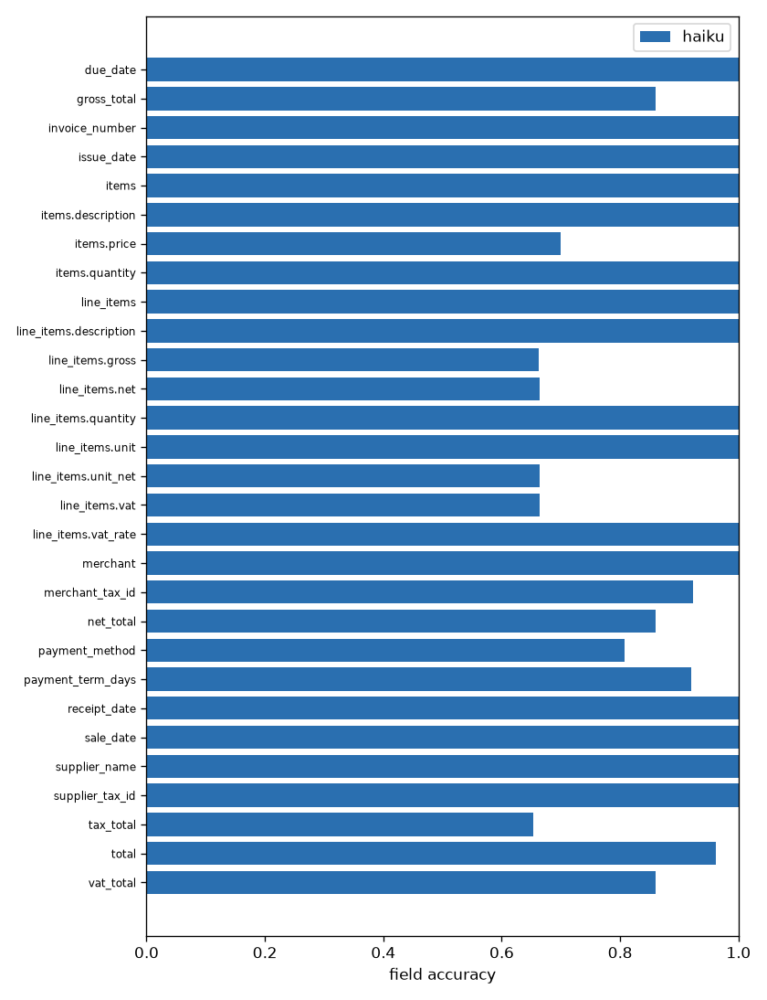
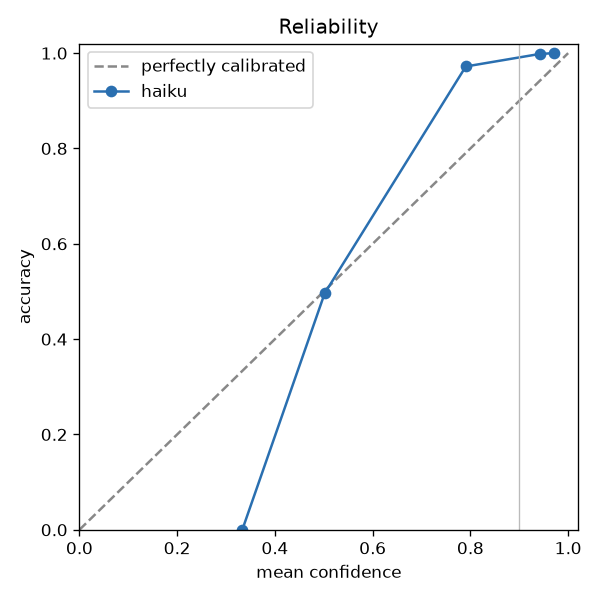
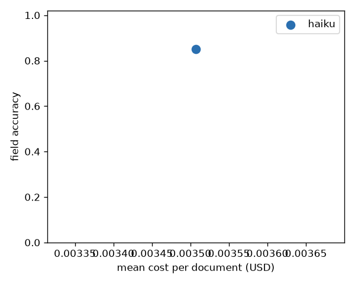

# Extraction eval report: baseline

Documents: 43, repeats: 2, started: 2026-11-27T11:13:43Z, git: a3b6a36597, dataset hash: 043b1c64150b, prompt hash: 29969e002fd6

## Summary

| metric | haiku |
| --- | --- |
| documents | 43 |
| model id | claude-haiku-5-5 |
| fieldAccuracy | 0.8498 |
| documentExactMatch | 0.8947 |
| classificationAccuracy | 1.0000 |
| hallucinationRate | 0.0000 |
| missRate | 0.0012 |
| ece | 0.0424 |
| verifiedPrecision | 0.9984 |
| errorCatchRate | 0.9936 |
| costUsdMean | 0.003507 |
| costUsd total | 0.301643 |

## How to read

- **Values** are scalar fields and table cells, each scored `correct`, `wrong`, `missed` (truth has a value, prediction empty), `hallucinated` (truth empty, prediction has a value) or `correct_absent` (both empty). Distractor documents have no values.
- **Field accuracy** = (correct + correct_absent) / all values. By field, table cells are `<field>.<column>`; by tag, a value counts under every tag of its document.
- **Document exact match** = share of documents with an expected type whose every required scalar field is correct (table cells ignored).
- **Classification accuracy** = share of all documents (distractors included) classified correctly. A distractor is correct when left unclassified.
- **Hallucination rate** = hallucinated / values whose truth is empty. **Miss rate** = missed / values whose truth has a value.
- **Calibration** covers values that have a prediction; a value is right when `correct`. **ECE** = sum over bins of (n bin / N) x |accuracy - mean confidence|; lower is better.
- **Verified precision** = of values at or above 0.9 (`LOW_CONFIDENCE`, which the app shows as fine), the share that is correct.
- **Error-catch rate** = of wrong or hallucinated values, the share the app flags (confidence below 0.9).
- **Cost** per document = sum of its calls. **Latency** excludes calls that ended in `error`.
- **Rates** are fractions between 0 and 1. A rate with nothing to divide by shows `n/a`.
- **Difference** (in comparisons) = second minus first; cost ratio = second mean cost / first mean cost.

## Field accuracy

| model | overall | correct | wrong | missed | hallucinated | correct_absent |
| --- | --- | --- | --- | --- | --- | --- |
| haiku | 0.8498 | 4079 | 777 | 6 | 0 | 350 |

### By field

| field | haiku |
| --- | --- |
| due_date | 1.0000 |
| gross_total | 0.8600 |
| invoice_number | 1.0000 |
| issue_date | 1.0000 |
| items | 1.0000 |
| items.description | 1.0000 |
| items.price | 0.7000 |
| items.quantity | 1.0000 |
| line_items | 1.0000 |
| line_items.description | 1.0000 |
| line_items.gross | 0.6622 |
| line_items.net | 0.6641 |
| line_items.quantity | 1.0000 |
| line_items.unit | 1.0000 |
| line_items.unit_net | 0.6641 |
| line_items.vat | 0.6641 |
| line_items.vat_rate | 1.0000 |
| merchant | 1.0000 |
| merchant_tax_id | 0.9231 |
| net_total | 0.8600 |
| payment_method | 0.8077 |
| payment_term_days | 0.9200 |
| receipt_date | 1.0000 |
| sale_date | 1.0000 |
| supplier_name | 1.0000 |
| supplier_tax_id | 1.0000 |
| tax_total | 0.6538 |
| total | 0.9615 |
| vat_total | 0.8600 |

### By document type

| type | haiku |
| --- | --- |
| invoice | 0.8445 |
| receipt | 0.8977 |

### By tag

| tag | haiku |
| --- | --- |
| chf | 0.6839 |
| computed-not-printed | 0.8203 |
| date-dmy | 0.8143 |
| date-iso | 0.8311 |
| date-localized-month | 0.7550 |
| date-long | 0.9970 |
| date-mdy | 0.9432 |
| eur | 0.9138 |
| gbp | 0.9829 |
| jpg | 0.8815 |
| jpy | 0.5654 |
| lang-de | 0.8586 |
| lang-en | 0.8751 |
| lang-es | 0.9244 |
| lang-fr | 0.9773 |
| lang-pl | 1.0000 |
| lang-sv | 0.5522 |
| layout-a | 0.8391 |
| layout-b | 0.7869 |
| layout-c | 0.9978 |
| missing-optional | 0.8148 |
| mock-sample | 1.0000 |
| multi-page | 0.8443 |
| no-currency | 0.9961 |
| photo | 0.8977 |
| photo-hard | 0.8922 |
| photo-light | 0.8478 |
| photo-medium | 0.9254 |
| png | 0.9444 |
| scanned | 0.8644 |
| sek | 0.5817 |
| text-pdf | 0.8409 |
| usd | 1.0000 |

## Document exact match

| model | documentExactMatch |
| --- | --- |
| haiku | 0.8947 |

## Classification

| model | classificationAccuracy |
| --- | --- |
| haiku | 1.0000 |

### Confusion: haiku (rows expected, columns predicted)

| expected | invoice | receipt | unclassified |
| --- | --- | --- | --- |
| invoice | 50 | 0 | 0 |
| none | 0 | 0 | 10 |
| receipt | 0 | 26 | 0 |

## Hallucination and miss rates

| model | hallucinationRate | missRate |
| --- | --- | --- |
| haiku | 0.0000 | 0.0012 |

## Calibration

| model | ece | verifiedPrecision | errorCatchRate |
| --- | --- | --- | --- |
| haiku | 0.0424 | 0.9984 | 0.9936 |

### Reliability: haiku

| confidence bin | count | mean confidence | accuracy |
| --- | --- | --- | --- |
| 0 to 0.5 | 3 | 0.3333 | 0.0000 |
| 0.5 to 0.7 | 1518 | 0.5018 | 0.4960 |
| 0.7 to 0.9 | 143 | 0.7906 | 0.9720 |
| 0.9 to 0.97 | 2783 | 0.9414 | 0.9982 |
| 0.97 to 1 | 409 | 0.9706 | 1.0000 |

## Cost and latency

| model | mean | p50 | p95 | total |
| --- | --- | --- | --- | --- |
| haiku | 0.003507 | 0.002505 | 0.009717 | 0.301643 |

Latency in ms (p50 / p95):

| model | ocr | classify | extract | total |
| --- | --- | --- | --- | --- |
| haiku | 1410.5 / 7978.0 | 1272.0 / 2085.2 | 13070.0 / 43649.8 | 17477.5 / 47496.8 |

## Opus vs Haiku

Needs exactly two models (or opus and haiku); this run has haiku.

## Spread across repeats

### haiku

| metric | min | max | std |
| --- | --- | --- | --- |
| fieldAccuracy | 0.8127 | 0.8868 | 0.0524 |
| documentExactMatch | 0.8947 | 0.8947 | 0.0000 |
| classificationAccuracy | 1.0000 | 1.0000 | 0.0000 |
| hallucinationRate | 0.0000 | 0.0000 | 0.0000 |
| missRate | 0.0012 | 0.0012 | 0.0000 |
| ece | 0.0585 | 0.0632 | 0.0033 |
| verifiedPrecision | 0.9980 | 0.9988 | 0.0006 |
| errorCatchRate | 0.9932 | 0.9938 | 0.0004 |
| costUsdMean | 0.003504 | 0.003511 | 0.000005 |

